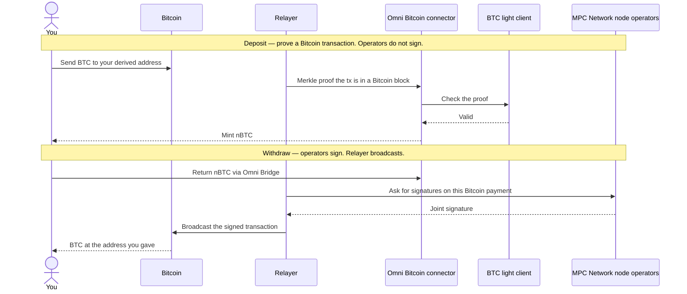
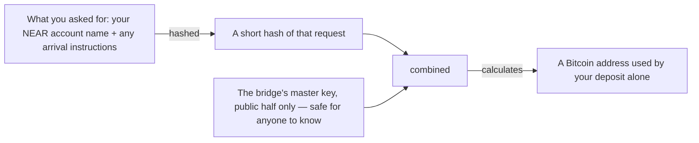
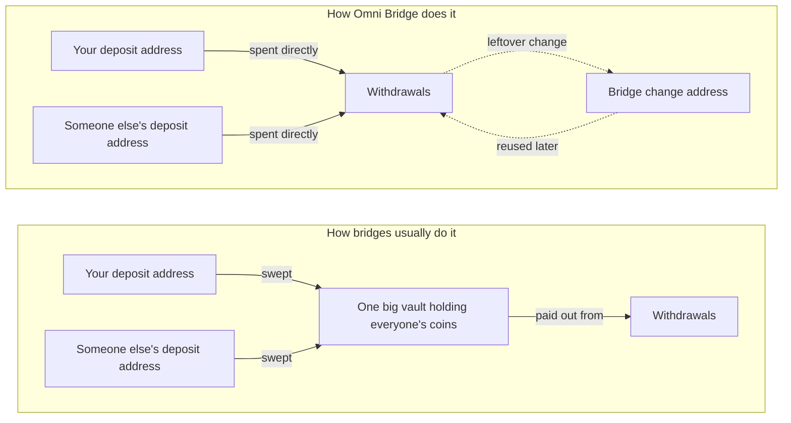
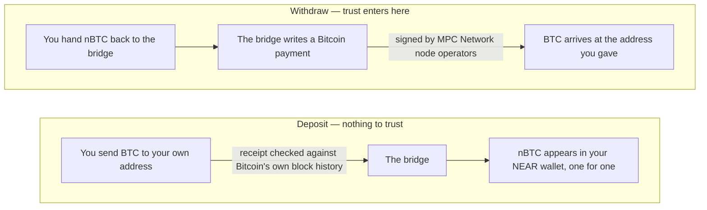
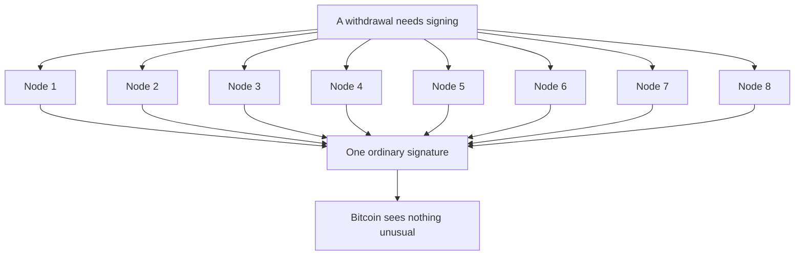

> ## Documentation Index
> Fetch the complete documentation index at: https://docs.near-intents.org/llms.txt
> Use this file to discover all available pages before exploring further.

# How the Bitcoin bridge works

> Where a BTC deposit address comes from, why coins are not swept into a vault, and who can sign a withdrawal

A plain-language guide for people using the bridge, not building it. Four things worth understanding: where your deposit address comes from, why your coins never get swept into a vault, why going in is safer than coming out, and who actually holds the key.

This is the Bitcoin side of [Omni Bridge](/learn/omni-bridge/overview). Omni's UTXO connector uses the same custody model for other UTXO chains it supports; this page walks Bitcoin because that is the UTXO path Intents readers hit. You send BTC. You receive **nBTC** (Bitcoin on NEAR, one for one). You can later return nBTC and get BTC back. Every step described here happens on-chain and is publicly checkable.

## What is already running vs what your action does

The [MPC Network](https://docs.near.org/chain-abstraction/chain-signatures) node operators are **already up**. The key is **already split**. Nobody boots a signer because you asked for an address.

| Your action | What happens | What does **not** happen |
| - | - | - |
| Get a deposit address | The address is **calculated** from the public key and your request | Operators are not contacted. Nothing is signed. |
| Deposit BTC | You send coins. A **relayer** submits a Merkle proof: evidence that your Bitcoin transaction sits in a Bitcoin block. A light client on NEAR checks that proof, then nBTC is minted. | Operators do not sign. This is not broadcasting a pre-signed Bitcoin transaction. You do not have to submit the proof yourself unless nobody else does. |
| Withdraw to Bitcoin | [MPC Network](https://docs.near.org/chain-abstraction/chain-signatures) node operators jointly sign **this** Bitcoin payment. A relayer then broadcasts that signed transaction. | The key is not assembled. A new operator group is not started for you. |

A **relayer** carries proofs and broadcasts signed transactions. **MPC Network node operators** are the group that can sign. Do not merge them: a missing relayer is replaceable; a missing operator group cannot sign a withdraw.

On the way **in**, the relayer shows the bridge a proof of Bitcoin history (transaction inclusion). On the way **out**, the relayer's job is closer to what you may already assume: take a signed Bitcoin transaction and put it on chain.

***

## 1. Your bitcoin gets an address of its own

You never send bitcoin to one shared bridge wallet. You tell the bridge who you are on NEAR, plus anything you want done with the tokens when they arrive, and it turns that request into an address that belongs to that request and nothing else.

The address is not looked up or handed out from a list. It is **calculated**, which means anyone can recalculate it and confirm those coins were always meant for you. Ask twice with the same details, get the same address twice. Change one character of the request and you get a completely different address.

Nothing secret is involved in producing it. The master key ingredient is a public key. The private half does not exist in one piece anywhere (see [section 4](#4-the-key-does-not-exist-in-one-piece)). Getting this address does not call the operators and does not create a signature.

***

## 2. Why there is no vault

Most bridges work like a bank branch: you deposit into an address, the bridge sweeps it into one large vault wallet, and withdrawals are paid out of that vault. Omni Bridge skips that middle step on Bitcoin. **Your coins stay exactly where you sent them until someone withdraws.**

When someone withdraws, the bridge builds a Bitcoin payment that spends a handful of deposit addresses directly as its funding. Each of those addresses is signed for **separately, with its own key**. A withdrawal drawing on three deposit addresses needs three independent signatures, not one master signature over everything.

### What that buys you

* **No honeypot.** There is no single address that ever holds everyone's coins, so there is no single address worth attacking. An attacker who somehow compromised one deposit address would reach exactly one deposit.
* **No extra hop.** A sweep is a real Bitcoin transaction: it costs a fee, takes confirmations, and creates a window where your coins are in motion between two places the bridge controls. Skipping it removes all three.
* **Nothing to drain.** Because each address needs its own signature from the MPC Network node operators, there is no single approval that moves the whole pot.
* **Auditable by anyone.** Since deposit addresses are calculated rather than assigned, you can verify independently which deposit any coin belongs to. You do not have to take the bridge's word for it.

### The one exception: change

Bitcoin payments cannot spend part of an address. They spend it whole and send the remainder back as *change*, the way handing over a note gets you coins back. Withdrawal amounts rarely match deposit amounts exactly, so leftovers do accumulate at a single bridge-controlled change address (itself calculated from the bridge's own account name, by the same recipe as section 1). Later withdrawals reuse that change as funding.

So the bridge does end up with a working balance in one place, but it arrives as **change from spending**, never as a sweep of your deposit. Your coins are never moved just to be stored somewhere else, and the change address is protected by exactly the same signing rules as everything else.

***

## 3. One direction is proved. The other is signed.

Bitcoin coming in and bitcoin going out are not mirror images, and this is the single most important thing to know about the bridge.

**Coming in**, the bridge is shown a Merkle proof from Bitcoin's own history and checks it. Either the proof holds up or nothing happens. There is no one to take your word for it, and no one whose word you have to take. Anyone can submit that proof. In practice a relayer does that for you after you send BTC — they are proving a transaction was included in a block, not executing a pre-signed Bitcoin payment. You only have to care if nBTC never appears — then the coins are still at your derived address, and you can [request a refund](/integration/bridging/btc-deposit-refund). If one relayer disappears, another can submit the same proof.

**Going out**, someone has to actually sign a Bitcoin payment on your behalf. That is a decision, not a check, and it is where trust enters the picture. That is the only step that needs the MPC Network node operators. After they sign, a relayer broadcasts that transaction on Bitcoin.

***

## 4. The key does not exist in one piece

There is no server with the bridge's private key on it, and no person who could be persuaded to hand it over. The key is split across independent [MPC Network](https://docs.near.org/chain-abstraction/chain-signatures) node operators, and each one holds a fragment that is useless on its own. The diagram below uses eight nodes as a picture of a group — not a promise that there are exactly eight.

This signing is [NEAR Chain Signatures](https://docs.near.org/chain-abstraction/chain-signatures): a threshold scheme where fragments combine into one ordinary signature. Bitcoin cannot tell it apart from a signature made by a lone wallet.

Each operator computes its own piece of the answer and the pieces combine. No operator ever sees the whole key, not even while signing. Take away any single operator and the signature still forms. Take away the group and no one, including the bridge's own developers, can move the coins.

This round of signing happens **per withdrawal**, not when you ask for a deposit address, and not when nBTC is minted.

***

## In short: what you are actually trusting

| | Bitcoin → nBTC | nBTC → Bitcoin |
| - | - | - |
| **You trust** | Nobody | The MPC Network node operators |
| **What settles it** | Evidence from Bitcoin's own history | A signature those operators produce together |
| **Can one bad actor break it?** | No. A forged receipt fails the check. | No. No single operator can sign. |
| **Can everyone going offline stop it?** | No. Anyone can submit the receipt. | Yes. Signing needs the group. |

And in both directions: your coins sit at an address derived from your own deposit request, never pooled into a vault, until the moment they are spent.

This documentation is built and hosted on [Mintlify](https://mintlify.com), a developer documentation platform.